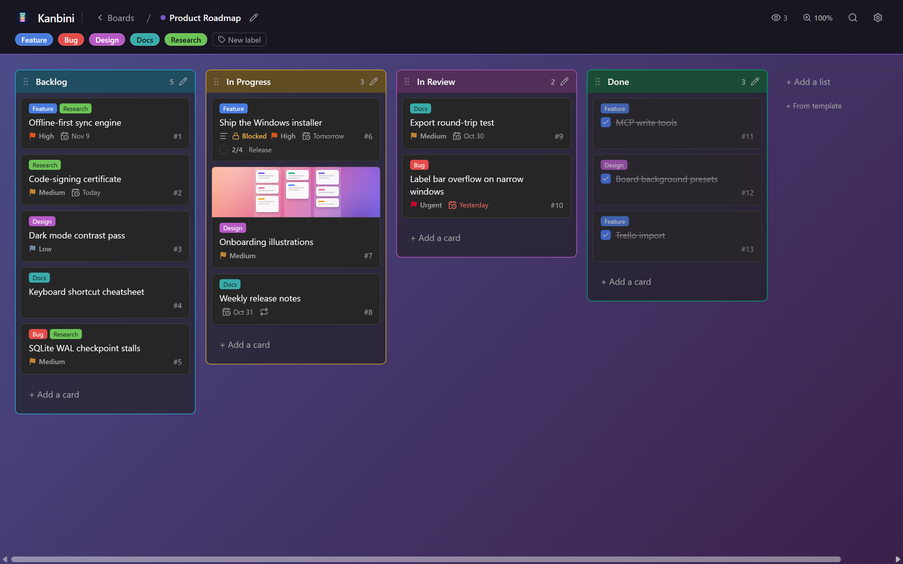
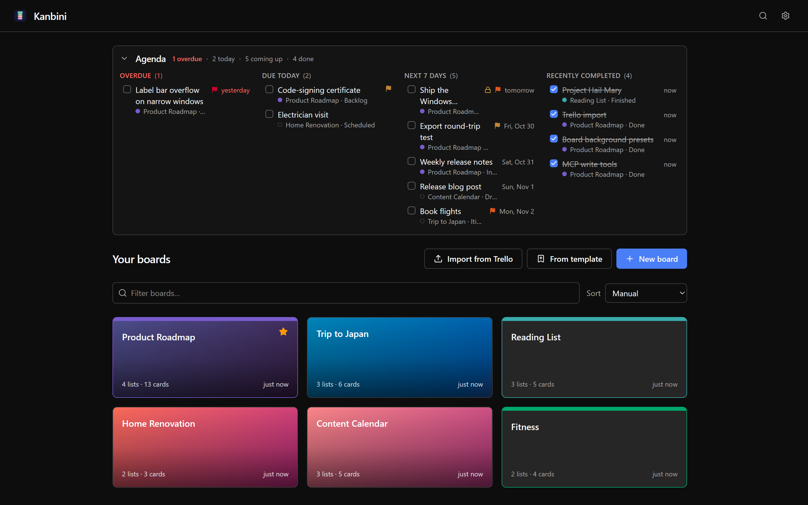
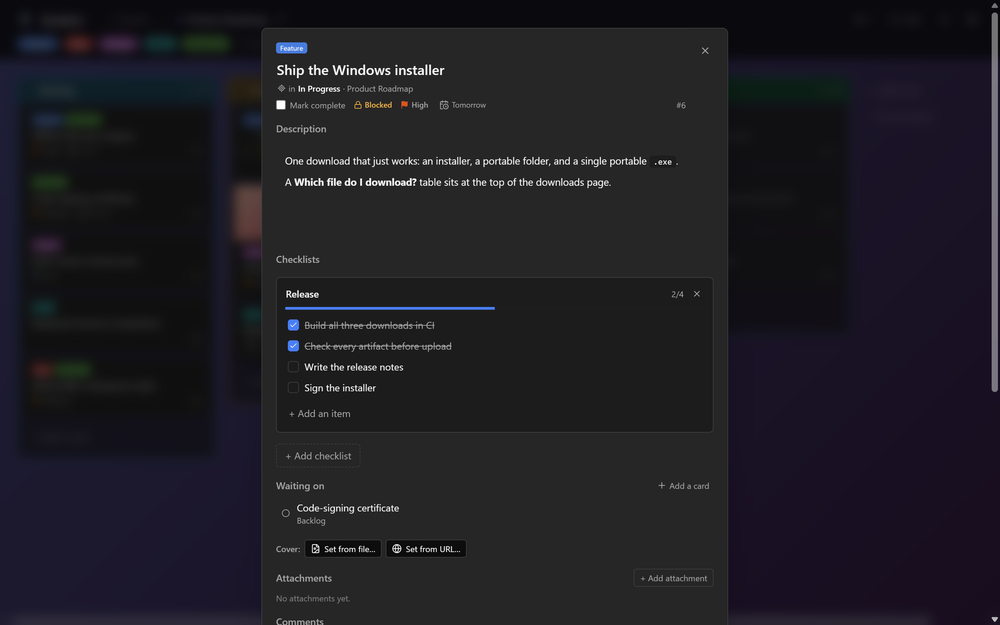
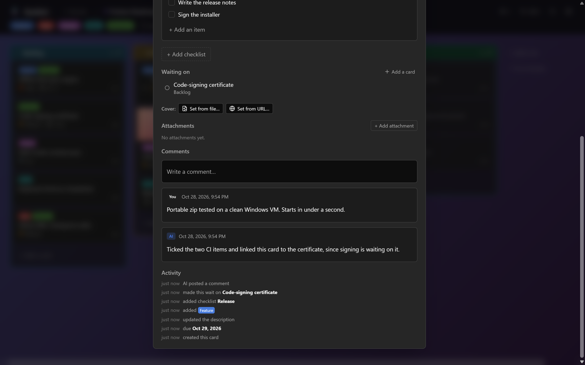
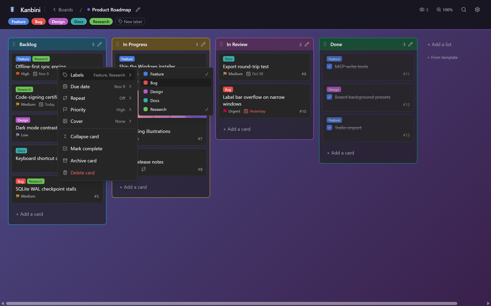
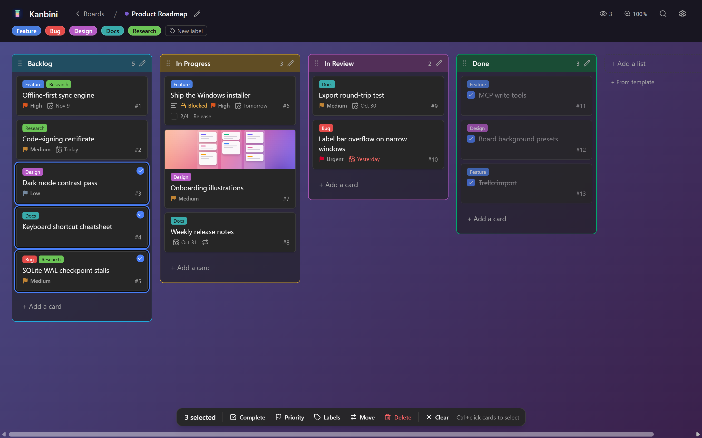
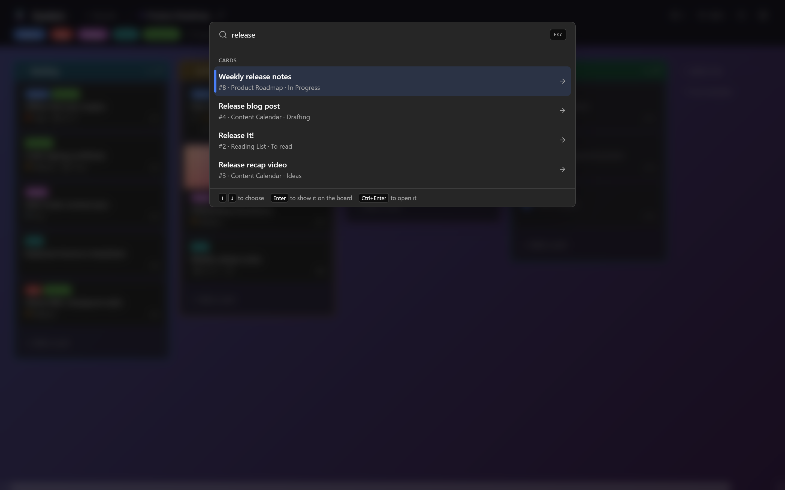
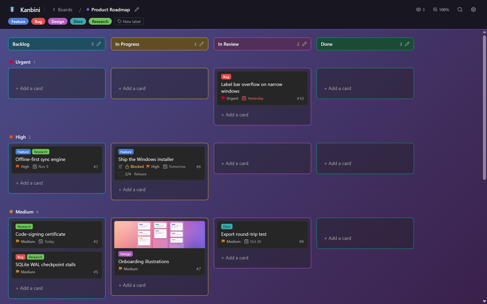
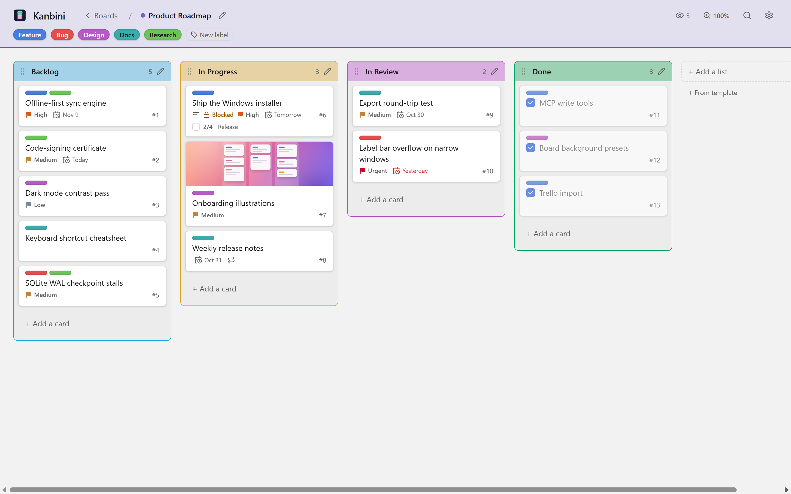

# Kanbini

[](https://github.com/Jigglyy/kanbini/actions/workflows/ci.yml)
[](LICENSE)

> **A kanban board that lives on your machine - and lets your AI move the cards.**
> Offline-first. Plain text on disk. No cloud, no accounts, no telemetry.

<p align="center">
  
</p>

Kanbini is a Trello-style kanban app built for one person and their AI.
Your boards live in a local SQLite file and export to plain Markdown +
JSON, so you own your data outright. A built-in **local MCP server** lets
any AI that speaks MCP - Claude, ChatGPT, Cursor, or your own agent -
read and rearrange your board while you watch the cards move in real time.

The pitch is simple: your tasks shouldn't need an internet connection, a
login, or a monthly fee just to exist. Kanbini keeps your whole board in
a local file you fully own, runs as a fast native app, and - when you
want a hand - lets an AI pull up a chair and move the cards in real time
while you watch.

The name mashes **kanban** with **konbini**, the Japanese corner store
that never closes: a board that's yours, local, and always on.

## Why Kanbini

- **Offline by default.** No accounts, no network, no telemetry. The only
  things that ever leave your machine are the ones you explicitly turn on
  - link previews and one-way Obsidian export - both off by default.
- **You own your data.** Everything is a local SQLite file with
  first-class, lossless plain-text export (Markdown + JSON), verified
  byte-identical by a round-trip test.
- **AI-native.** A token-gated local MCP server exposes read/write tools;
  the AI's edits stream into the live UI as it works.
- **Free and open source** under the [MIT license](LICENSE).

## Screenshots

| Agenda + all your boards | Card detail, with where the card lives |
| :---: | :---: |
| [](docs/screenshots/home.png) | [](docs/screenshots/card-detail.png) |
| **Waiting on, comments (one from the AI) + activity** | **Right-click menus with fly-outs** |
| [](docs/screenshots/card-activity.png) | [](docs/screenshots/card-menu.png) |
| **Select several cards, act on all of them** | **Ctrl+F search across every board** |
| [](docs/screenshots/multi-select.png) | [](docs/screenshots/command-palette.png) |
| **Swimlanes - group by priority** | **Light theme** |
| [](docs/screenshots/swimlanes.png) | [](docs/screenshots/board-light.png) |

## Features

- **Boards, lists, cards** with drag-and-drop (live cross-list reorder),
  labels, due dates, priorities, per-list colours, and swimlanes (group
  by priority).
- **Card depth** - WYSIWYG description (saved as Markdown), checklists,
  comments, local attachments (paste an image straight in), cover images,
  and a per-card activity log. Cards with a description show a small marker
  in the list.
- **Long boards stay readable** - each list scrolls on its own, a card
  can be collapsed to a one-line summary (or a whole list set to compact),
  and a list can show just its first 10 / 20 / 50 cards with a "Show more"
  button.
- **Multi-select** - Ctrl/Cmd-click cards (or Shift-click for a range) to
  pick several at once, then complete, set priority, re-label, move, or
  delete them in bulk from a floating action bar (or a right-click menu) -
  and drag the whole group between lists.
- **Local MCP server** - a token-gated 127.0.0.1 control channel + stdio
  server (`@kanbini/mcp`) with 30 read/write tools: cards, lists, boards,
  labels, comments, checklists, attachments, archiving, list settings
  (card limit, sort, colour, compact cards, how many to show), "waiting
  on" links, search, and a cross-board agenda.
  Edits stream into the open UI live. See [`docs/MCP.md`](docs/MCP.md).
- **Claude Code plugin** - `/plugin marketplace add Jigglyy/kanbini`,
  then `/plugin install kanbini@kanbini`. Adds `/kanbini:agenda`,
  `/kanbini:new-card`, and `/kanbini:log` (write up this session's work
  as a finished card), and needs no token or path: it finds the Kanbini
  app you installed. See [`plugins/kanbini`](plugins/kanbini/README.md).
- **Scriptable HTTP API** - the same token-gated 127.0.0.1 control channel
  is also a plain local HTTP API (REST routes for reads + writes, plus a
  batch endpoint that lands as one undo step) for non-MCP tools, scripts,
  and automation. Loopback only. See [`docs/MCP.md`](docs/MCP.md).
- **Own your data** - lossless plain-text export/import (`kanbini.json` +
  `cards/*.md` + attachment files); Backup + Restore live in Settings.
- **Cross-board search** via a Ctrl/Cmd+F command palette.
- **Repeating cards** - make a card repeat daily, weekly, monthly, yearly,
  or every N of those. Completing it adds the next one with its due date
  moved on, labels and checklist carried over (unticked).
- **Waiting on** - mark that a card can't start until another is done,
  even one on a different board. The card shows "Blocked" until then.
- **Agenda** on the home screen - what's overdue, due today, coming up
  this week, and recently completed, across every board. Tick a card off
  right there, or click it to jump to the card.
- **Templates** for boards and lists.
- **Undo / redo** with full snapshot restore on delete.
- **Customizable keyboard shortcuts.**
- **Board backgrounds** (colour / gradient / image) and continuous zoom.
- **Trello import** - bring an exported Trello board JSON in as a new board.
- **Opt-in integrations** (off by default): link previews and one-way
  push to an Obsidian vault.

## Install

**Windows:** the [Releases](https://github.com/Jigglyy/kanbini/releases)
page has three downloads (the "Source code" ones are for developers).
All three use the same boards, in `%APPDATA%\Kanbini`.

- **`Kanbini.Setup.X.Y.Z.exe`** installs Kanbini for your user (no admin
  rights needed) with a Start menu entry and an uninstaller. To update,
  run the newer installer.
- **`Kanbini-X.Y.Z-win-x64-portable.zip`** is the portable folder:
  extract it anywhere and run `Kanbini.exe` inside. Nothing is installed
  and nothing goes in the registry. To update, replace the folder.
- **`Kanbini-X.Y.Z-win-x64-portable-single-file.exe`** is the same
  portable app as one file: just run it. It unpacks itself into a
  temporary folder each time (so it takes a few seconds longer to open)
  and cleans that up when you close it. Connecting an AI to it needs
  Node.js installed.

Builds are unsigned, so Windows SmartScreen warns on the first run
("More info", then "Run anyway").

**macOS:** download **`Kanbini-X.Y.Z-mac-universal.dmg`** (one app for
both Apple Silicon and Intel Macs), open it and drag Kanbini into
Applications. The app isn't notarized by Apple, so the first launch is
blocked with "Apple could not verify..." Click "Done", then go to
System Settings → Privacy & Security, scroll down and click "Open
Anyway". You only do this once. Boards live in
`~/Library/Application Support/Kanbini`.

**Linux** (x64): two downloads, both using the same boards in
`~/.config/Kanbini`.

- **`Kanbini-X.Y.Z-linux-amd64.deb`** for Debian and Ubuntu:
  `sudo apt install ./Kanbini-X.Y.Z-linux-amd64.deb`. The best pick on
  Ubuntu 24.04 and newer, because it sets up the browser sandbox that
  release needs.
- **`Kanbini-X.Y.Z-linux-x86_64.AppImage`** for any distro: `chmod +x`
  it and run it. Needs FUSE 2 (`libfuse2`). On Ubuntu 24.04 and newer,
  run it with `--no-sandbox` (or use the `.deb`). Connecting an AI to it
  needs Node.js installed.

Or run it from source:

```sh
pnpm install
pnpm --filter @kanbini/desktop dev
```

It opens on a seeded sample board. After a fresh clone or any Electron
version bump, run the native rebuild once:

```sh
pnpm --filter @kanbini/desktop rebuild:native
```

To build it yourself, see [`docs/PACKAGING.md`](docs/PACKAGING.md).
Each platform builds on its own OS (Windows on Windows, the `.dmg` on a
Mac, the AppImage + `.deb` on Linux or WSL2); the release workflow does
all three on GitHub Actions and boots each packaged app before
publishing. Windows is the platform used day to day; the macOS and Linux
builds are newer, so please [open an
issue](https://github.com/Jigglyy/kanbini/issues) if something's off
there.

## Wire up an AI

The MCP server speaks the standard Model Context Protocol, so **any
MCP-capable client** can drive your board while it's open. Claude Desktop
and Claude Code are what we test against, but ChatGPT desktop, Cursor, or
your own agent work the same way - one config shape covers them all. The
snippet + token live in the app under **Settings → AI integration**;
details in [`docs/MCP.md`](docs/MCP.md).

## Develop

```sh
pnpm verify   # typecheck + unit tests + launch smoke (~20 s)
pnpm e2e      # Playwright end-to-end suite against the real Electron app
```

Exercise the MCP surface end-to-end (desktop app must be running):

```sh
pnpm --filter @kanbini/mcp run build         # one-time / after MCP changes
pnpm --filter @kanbini/mcp run smoke         # read-tool check
pnpm --filter @kanbini/mcp run smoke:write   # create → update → comment → checklist → delete
```

Prove the export/import round-trip is lossless (no live app needed):

```sh
pnpm --filter @kanbini/desktop run test:roundtrip
```

## Layout

```
/apps
  /desktop      Electron main + hardened preload + control channel
  /renderer     React + Vite + Tailwind v4 + ShadCN
  /mcp          @kanbini/mcp - stdio MCP server
  /desktop-e2e  Playwright end-to-end suite
/packages
  /shared       zod schemas, channel names, id/order utils
  /db           Drizzle schema + migrations + data access
/docs           DESIGN.md, MCP.md, PACKAGING.md
```

- Design & architecture → [`docs/DESIGN.md`](docs/DESIGN.md)
- MCP integration → [`docs/MCP.md`](docs/MCP.md)
- Packaging → [`docs/PACKAGING.md`](docs/PACKAGING.md)

## Contributing

Issues and pull requests are welcome. `pnpm verify` should be green before
you push. New features in `@kanbini/shared`, `@kanbini/db`, or
`@kanbini/renderer` should land with tests in the same change; bug fixes
should come with a regression test.

## License

[MIT](LICENSE) © Jigglyy and Kanbini contributors.
